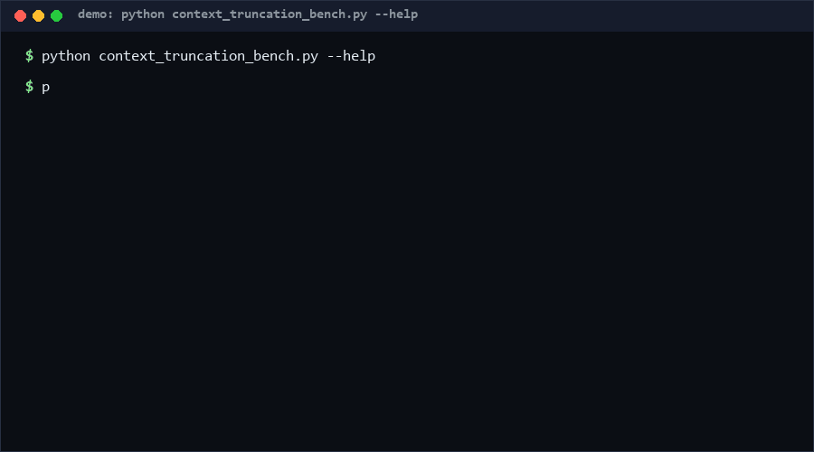

# context-truncation-bench

Benchmark context-window truncation strategies on the same corpus and compare how much information each one actually preserves. Six strategies (head, tail, middle, head-tail, top-importance, hybrid) are scored on token, importance-weighted and critical-item retention, so the choice of truncation policy becomes a measured decision instead of a habit. Pure Python, standard library only.

As of 2026-10-13, no direct equivalent found as of 2026-10-13: search across GitHub (194 queries) and the web surfaced LLM-framework context managers but no standalone, offline truncation-strategy benchmark harness.

<p align="center"></p>

## Problem

When a prompt or transcript exceeds the context window, something must be dropped. Teams pick a truncation rule — keep the head, keep the tail, summarise the middle — and rarely measure the consequences. Critical instructions get silently cut, weighted content disappears, and regressions go unnoticed because there is no shared yardstick. The decision deserves a benchmark, not a coin flip.

## How it works

1. **Unit model.** A corpus is a list of units: `{id, kind, text, critical}`. Kinds carry importance weights (`system` 1.0, `instruction` 0.9, `fact` 0.7, `example` 0.4, `noise` 0.1); units may be flagged `critical` (must-keep).
2. **Strategies.** `head`/`tail` greedily pack from one end; `middle` keeps the most centred sliding window that fits; `head_tail` splits the budget; `top_importance` packs by weight then restores original order; `hybrid` spends 40% on head, 40% on tail and 20% on the highest-importance remainder. The token budget is a hard contract in every strategy.
3. **Metrics.** For each strategy we report `token_retention`, `weighted_retention` (weight × tokens) and `critical_retention`, plus a composite score `0.6·weighted + 0.4·critical`. The winner is the highest composite.
4. **Determinism.** The synthetic corpus generator is seeded, so two runs of the same command produce identical tables.

## Quickstart

Requires Python 3.8+. No dependencies, no network. Full bench over a 500-unit synthetic corpus takes under 0.1 s [Measured].

```bash
python context_truncation_bench.py bench --synthetic 500 --budget 3000
# winner: top_importance   (printed as a table; add --json for machine output)

python context_truncation_bench.py bench --input my_units.json --budget 4000 --json
```

Units file format: a JSON list of `{"id": "...", "kind": "fact", "text": "...", "critical": false}`.

## Why not X

- **LLM-framework context managers** (agent SDKs with built-in window trimming): they implement *one* policy inside the framework; this repo benchmarks policies side by side and is framework-agnostic. No direct equivalent found as of 2026-10-13 for a standalone comparison harness.
- **Tokenizers / tiktoken-style counters**: they count tokens well but have no notion of importance weights, critical flags or strategy comparison.
- **Summarisation pipelines** (map-reduce compressors): they change content instead of selecting it, cost an LLM call per run, and are non-deterministic — unusable as a repeatable baseline.
- **Prompt-testing frameworks**: they score model answers, not the retention property of a truncation policy.

## Performance

Measured on Windows 10, Python 3.13, single core:

| Corpus | Time | Reproduce |
|---|---|---|
| 20,000 units, all 6 strategies [Measured] | 0.10 s | `python context_truncation_bench.py perf --units 20000` |
| 500-unit bench table [Measured] | < 0.05 s | `python context_truncation_bench.py bench --synthetic 500 --budget 3000` |

## Minimal Fallback

No Python available? The metric is computable in a spreadsheet: put unit weights in one column, mark kept rows after any manual cut, and compute `SUMPRODUCT(weight, tokens_kept) / SUMPRODUCT(weight, tokens)`. It reproduces `weighted_retention` exactly; `critical_retention` is a plain COUNTIF ratio.

## Design Trade-offs

- **Whitespace tokens, not a real tokenizer.** Deterministic and dependency-free, but budgets are in "words", not model tokens.
- **Composite score weights (0.6/0.4) are fixed.** Opinionated default keeps outputs comparable; copy `retention_metrics()` and re-weight if you disagree.
- **Greedy packing, not knapsack.** Strategies are O(n log n) at most; optimal subset selection would change the comparison into an optimisation contest.
- **Unsplittable units.** A single oversized unit is dropped (or blocks a window) rather than cut mid-text; truncation happens at unit boundaries only.

## Limits & Second-order Effects

- Results transfer only to corpora that resemble the unit mix; a noise-heavy corpus flatters `top_importance`.
- Teams may optimise for the benchmark (Goodhart): keep corpora representative of real traffic.
- The winner depends on the weight table; changing weights can flip the ranking — that is a feature, but it must be re-run after weight edits.
- Because `critical` units dominate the score, an over-flagged corpus makes all strategies look identical.

## FAQ

**When NOT to use this?** Do not use it as a runtime context manager — it is an offline benchmark, not a truncation service. Skip it if your pipeline already measures downstream answer quality per truncation policy; end-to-end scoring subsumes retention metrics.

**Does it call any LLM?** No. Everything is local arithmetic; "summary" strategies are out of scope by design.

**Can I add a strategy?** Add a function `fn(units, budget) -> kept_units` to `STRATEGY_FNS`; metrics and the CLI table pick it up automatically.

**Why is the budget a hard contract?** A strategy that overshoots the window defeats the purpose; the middle strategy shrinks its band rather than exceeding the cap.

## [Core Assumptions]

- **Kind weights approximate real value** (system > instruction > fact > example > noise). Confidence: medium — reasonable prior, corpus-dependent.
- **Critical flags exist and are sparse** (<15% of units). Confidence: medium — if everything is critical the metric loses discrimination.
- **Token ≈ whitespace word.** Confidence: high for planning, medium for billing-grade budgets.
- **Unit boundaries are the right cut points.** Confidence: high — mid-unit cuts corrupt content semantics.

As of 2026-10-13.

---

Part of the [zhengming-toolbox](https://github.com/chenhz01/zhengming-toolbox) — 105 purpose-built AI-engineering tools across neglected niches.

Related tools: [adr-staleness-check](https://github.com/chenhz01/adr-staleness-check) · [agent-stop-condition-spec](https://github.com/chenhz01/agent-stop-condition-spec) · [agent-loop-detector](https://github.com/chenhz01/agent-loop-detector)
